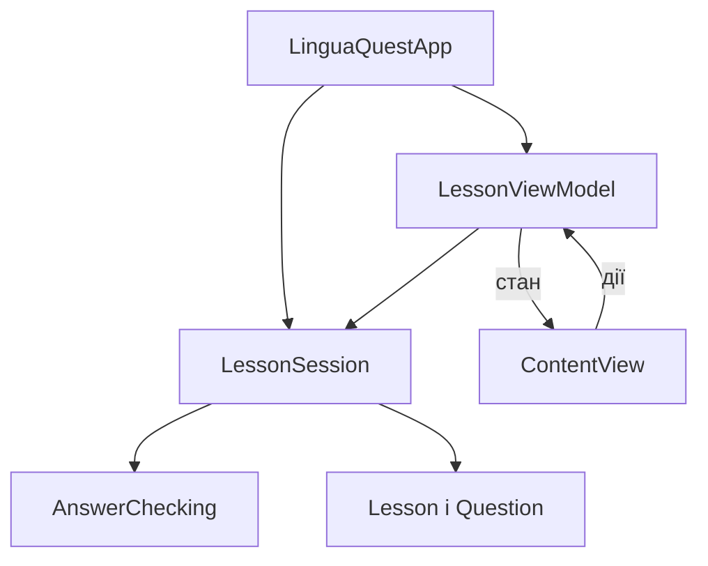

# Архітектура LinguaQuest

## Вибір архітектури

Для iOS-частини використано MVVM. SwiftUI відображає стан
ViewModel та передає їй дії користувача. Це дозволяє
відокремити інтерфейс від правил проходження уроку.

Для невеликого застосунку цей підхід дає зрозумілий розподіл
відповідальностей без великої кількості додаткових компонентів.

## Компоненти

| Компонент        | Відповідальність                                |
|------------------|-------------------------------------------------|
| ContentView      | Відображає стан і передає дії користувача       |
| LessonViewModel  | Готує стан, підказки та повідомлення для екрана |
| LessonSession    | Керує спробами, балами, переходами та повтором  |
| AnswerChecking   | Визначає контракт перевірки відповіді           |
| AnswerChecker    | Реалізує перевірку відповіді                    |
| Question, Lesson | Зберігають дані предметної області              |
| LinguaQuestApp   | Створює компоненти та передає залежності        |

## Схема

## Робочий сценарій

Користувач вибирає відповідь у ContentView.
ViewModel передає індекс у LessonSession.
Сесія викликає AnswerChecking і змінює стан проходження.
ViewModel оновлює дані та повідомлення, які відображає SwiftUI.

Правила нарахування балів передаються в сесію ззовні.
Текстові повідомлення формуються у ViewModel.

## Перевірка

- Усі правильні відповіді: 3 виконані запитання, 3 бали.
- Дві помилки на apple, повторна правильна відповідь на book,
  правильна відповідь на sun: 2 виконані запитання, 1 бал.
- Підказка не змінює балів і не витрачає спробу.
- Повторне проходження очищає результат і повідомлення.

## Наступні етапи

Підключити спільну бібліотеку LinguaQuestCore, репозиторій
уроків і патерни. Консольну версію перевести на LessonSession.