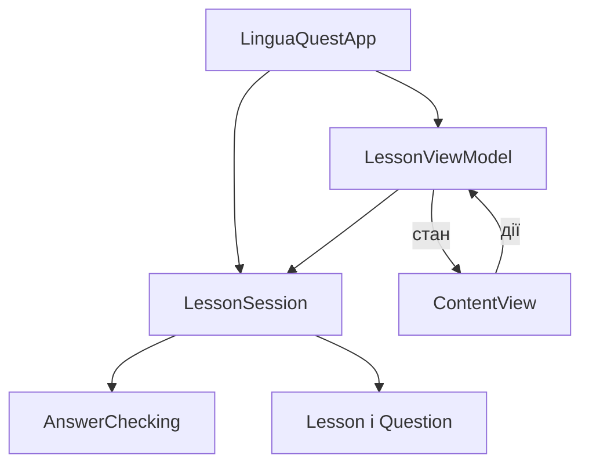

# Архітектура LinguaQuest

## Вибір архітектури

Для iOS-частини використано MVVM. SwiftUI відображає стан
ViewModel та передає їй дії користувача. Це дозволяє
відокремити інтерфейс від правил проходження уроку.

Для невеликого застосунку цей підхід дає зрозумілий розподіл
відповідальностей без великої кількості додаткових компонентів.

Спільні моделі, перевірку відповідей, Builder, репозиторій
та Decorator винесено в бібліотеку LinguaQuestCore.
Консольна версія вже використовує цю бібліотеку.
Її підключення до iOS та перенесення LessonSession
залишаються наступним етапом інтеграції.

## Компоненти

| Компонент               | Відповідальність                                                        |
|-------------------------|-------------------------------------------------------------------------|
| ContentView             | Відображає стан і передає дії користувача                                |
| LessonViewModel         | Готує стан, підказки та повідомлення для екрана                           |
| LessonSession           | Керує спробами, балами, переходами та повтором                            |
| AnswerChecking          | Визначає контракт перевірки відповіді                                    |
| AnswerChecker           | Реалізує перевірку відповіді                                             |
| AnswerResult            | Позначає результат перевірки: correct, incorrect або invalid              |
| Question, Lesson        | Зберігають дані предметної області                                       |
| LessonBuilder           | Поетапно складає урок і перевіряє його дані                               |
| LessonRepository        | Визначає контракт отримання уроку                                        |
| InMemoryLessonRepository | Зберігає вихідні дані в пам’яті та створює урок через Builder            |
| LoggingAnswerChecker    | Додає журналювання до перевірки, зберігаючи її результат                  |
| LinguaQuestApp          | Створює компоненти iOS та передає залежності                              |

## Схема iOS



Схема відображає наявний сценарій iOS до інтеграції спільної
бібліотеки. Репозиторій та Decorator поки підключені до консольної
версії.

## Робочий сценарій iOS

Користувач вибирає відповідь у ContentView.
ViewModel передає індекс у LessonSession.
Сесія викликає AnswerChecking і змінює стан проходження.
ViewModel оновлює дані та повідомлення, які відображає SwiftUI.

Правила нарахування балів передаються в сесію ззовні:
правильно виконане запитання дає 1 бал, невиконане — 0 балів.
Перша помилка дозволяє відповісти повторно без зміни балів.
Підказка не витрачає спробу та не впливає на результат.

Текстові повідомлення формуються у ViewModel.

## Перевірка сценарію

- Усі правильні відповіді: 3 виконані запитання, 3 бали.
- Дві помилки на apple, повторна правильна відповідь на book,
  правильна відповідь на sun: 2 виконані запитання, 2 бали.
- Підказка не змінює балів і не витрачає спробу.
- Повторне проходження очищає результат і повідомлення.

## Поведінковий патерн Observer

Проблема: інтерфейс повинен реагувати на зміну балів,
поточного запитання, підказки та повідомлень.

Використано механізм спостереження Combine і SwiftUI.

| Учасник            | Реалізація                              |
|--------------------|-----------------------------------------|
| Джерело стану      | LessonViewModel: ObservableObject       |
| Публікація змін    | Властивості з @Published                |
| Спостереження UI   | @StateObject у ContentView              |
| Тестовий підписник | Підписка на viewModel.$score через sink  |

LessonViewModel оновлює опубліковані властивості після дій
користувача. SwiftUI отримує повідомлення та оновлює відображення.

Механізм підписок надає фреймворк. Код проєкту визначає
опублікований стан і підключає його до інтерфейсу.

Тест testScoreChangesNotifyObserver створює підписку на бали
та перевіряє отримання значень [0, 1] після правильної відповіді.

## Принципи SOLID

| Принцип | Компонент                                                | Застосування                                                                                                         |
|---------|----------------------------------------------------------|----------------------------------------------------------------------------------------------------------------------|
| SRP     | ContentView, LessonViewModel, LessonSession, AnswerChecker | Відображення, підготовка стану, правила проходження та перевірка розділені                                            |
| OCP     | LessonSession, AnswerChecking                            | Сумісний перевіряльник, зокрема Decorator, можна підключити без зміни коду сесії                                        |
| LSP     | Контракт AnswerChecking                                  | Робочі реалізації мають однаково трактувати correct, incorrect та invalid; Decorator зберігає результат обгорнутого компонента |
| ISP     | AnswerChecking, LessonRepository                         | Протоколи містять потрібні споживачам операції перевірки та отримання уроку                                             |
| DIP     | LessonSession, запуск CLI                                | Перевіряльник і джерело уроку використовуються через протоколи                                                         |

Контракт AnswerChecking: недопустимі індекси дають invalid,
збіг вибраного та правильного індексів — correct,
інший допустимий варіант — incorrect.

LoggingAnswerChecker зберігає контракт обгорнутого перевіряльника
та додає журналювання. Це перевіряється тестом
testDecoratorPreservesResultsAndLogsOncePerCheck.

Окремі ієрархії успадкування для демонстрації SOLID
не створювалися. Заміна компонентів організована через протоколи.

## Впровадження залежностей

LinguaQuestApp створює урок, перевіряльник та функцію
нарахування балів і передає їх у LessonSession.
Готова сесія передається в LessonViewModel.

DI — спосіб передати залежність ззовні.
DIP — принцип залежності від абстракції замість конкретної
реалізації змінюваного компонента.

У тесті testInjectedCheckerIsUsed використовується
TestAnswerChecker замість AnswerChecker.

Заглушка повертає наперед заданий результат і фіксує виклики.
Тест перевіряє передачу та використання залежності
без зміни LessonSession.

У консольній версії запуск програми створює
InMemoryLessonRepository і отримує урок через LessonRepository.
Перевіряльник створюється як LoggingAnswerChecker,
що обгортає AnswerChecker, і передається в runLesson
через протокол AnswerChecking.

Функція log також передається ззовні. Бібліотека формує
повідомлення, а консоль визначає спосіб його виведення.

## Антипатерни та покращення

| Проблема                            | Рішення або поточний стан                                                                        |
|-------------------------------------|-------------------------------------------------------------------------------------------------|
| Перевантажений ContentView           | Правила проходження винесено в LessonSession, повідомлення — у ViewModel                         |
| Приховані залежності                 | Компоненти передаються через ініціалізатори                                                       |
| Створення уроку всередині екрана      | Перенесено в LinguaQuestApp                                                                      |
| Повторне нарахування балів           | Сесія ігнорує відповіді на завершене запитання                                                    |
| Змішування перевірки та журналювання | Журналювання винесено в LoggingAnswerChecker                                                     |
| Отримання даних уроку в коді запуску | CLI отримує урок через LessonRepository                                                         |
| Дублювання між CLI та iOS            | Залишається до підключення бібліотеки до iOS і переведення CLI на спільний LessonSession          |

## Спільна бібліотека LinguaQuestCore

Бібліотека містить Question, Lesson, AnswerResult, AnswerChecking,
AnswerChecker, LessonBuilder, LessonRepository,
InMemoryLessonRepository та LoggingAnswerChecker.

У Package.swift оголошено бібліотечний продукт LinguaQuestCore
та залежність консольної цілі LinguaQuestCLI від цієї бібліотеки.
Консольна програма підключає модуль через import LinguaQuestCore.

Типи, властивості та ініціалізатори, які мають бути доступними
з інших модулів, позначено public.

Початкові назва та запитання зберігаються в BeginnerLessonData.
Цей допоміжний тип використовується тільки всередині бібліотеки.
Lesson.beginner() та стандартний InMemoryLessonRepository
отримують дані з одного набору.

LessonSession поки залишається в iOS-частині.
Консоль продовжує використовувати власну функцію runLesson.

## Породжувальний патерн Builder

LessonBuilder створює урок поетапно: отримує назву,
накопичує запитання через addQuestion та повертає Lesson
після виклику build().

Перед створенням уроку перевіряються:

- назва не порожня і не складається тільки з пробілів;
- урок містить хоча б одне запитання;
- слово та варіанти відповіді не порожні й не складаються тільки з пробілів;
- список варіантів відповіді не порожній;
- індекс правильної відповіді належить масиву варіантів.

Якщо дані некоректні, build() викидає LessonBuilderError:
emptyTitle, emptyLesson або invalidQuestion(index:).
Некоректний урок при цьому не повертається.

У робочому сценарії Builder використовується всередині
InMemoryLessonRepository.loadLesson(). Репозиторій передає
назву, додає запитання та викликає build().

## Репозиторій уроків

LessonRepository визначає контракт отримання уроку:

```swift
func loadLesson() throws -> Lesson
```

InMemoryLessonRepository зберігає вихідні дані в пам’яті
та створює готовий урок через LessonBuilder.

Ініціалізатор без параметрів використовує початкові три запитання.
Ініціалізатор із title та questions дозволяє передати власні дані,
зокрема для тестування.

Консоль отримує урок через протокол LessonRepository.
Це дозволяє підключити іншу реалізацію джерела даних,
яка дотримується того самого контракту.

Помилки складання уроку передаються через throws
та обробляються в коді запуску CLI за допомогою do-catch.

## Структурний патерн Decorator

LoggingAnswerChecker реалізує AnswerChecking та зберігає
всередині інший об’єкт, який відповідає цьому протоколу.

Під час перевірки він:

1. Передає відповідь обгорнутому перевіряльнику.
2. Отримує результат перевірки.
3. Записує повідомлення через передану функцію log.
4. Повертає результат без змін.

Таким чином, Decorator додає журналювання, зберігаючи
правила перевірки та контракт AnswerChecking.

У консольній програмі LoggingAnswerChecker обгортає AnswerChecker,
а функція log виводить повідомлення через print.

Наприклад, після вибору першого варіанта для apple:

```text
[Перевірка] apple, індекс 0: correct
```

Користувач вводить номер варіанта 1, а перевіряльник отримує
індекс 0, оскільки індексація масиву починається з нуля.

## Автоматичні тести LinguaQuestCore

Тести пакета розташовані в
Tests/LinguaQuestCoreTests/CoreComponentsTests.swift.
Тестова ціль LinguaQuestCoreTests залежить від LinguaQuestCore.

| Тест                                          | Що перевіряє                                                                 |
|-----------------------------------------------|------------------------------------------------------------------------------|
| testBuilderPreservesQuestionOrder             | Збереження назви та порядку запитань під час складання уроку                   |
| testBuilderRejectsEmptyLesson                 | Відхилення уроку без запитань                                                  |
| testBuilderRejectsBlankTitle                  | Відхилення назви, яка складається з пробілів                                   |
| testBuilderRejectsInvalidCorrectAnswerIndex   | Відхилення індексу правильної відповіді за межами масиву                        |
| testRepositoryLoadsProvidedLessonData        | Отримання переданої назви та запитань через репозиторій                         |
| testDecoratorPreservesResultsAndLogsOncePerCheck | Збереження результатів, одна перевірка та один запис у журнал на кожний виклик |

CountingAnswerChecker рахує звернення та делегує фактичну
перевірку звичайному AnswerChecker.

Тест Decorator перевіряє correct, incorrect та invalid,
включно з від’ємним індексом і значенням за межами масиву.
Після кожного виклику перевіряється результат,
кількість звернень до перевіряльника та кількість повідомлень.

Тести помилок Builder перевіряють факт викидання помилки.
У наведених тестах не перевіряється конкретний варіант
LessonBuilderError.

Команда запуску тестів пакета на Windows:

```bash
swift test --build-system native
```

Ці шість тестів перевіряють спільні компоненти бібліотеки.
Наявні десять iOS-тестів перевіряють сесію та ViewModel
і запускаються окремо в Xcode.

## Наступні етапи

Підключити LinguaQuestCore до iOS та перенести до бібліотеки
LessonSession.

Використати InMemoryLessonRepository та LoggingAnswerChecker
під час створення компонентів iOS-застосунку.

Перевести консольну версію на спільний LessonSession.

Перевірити обидві версії після інтеграції та оновити
архітектурну схему відповідно до підсумкової структури.