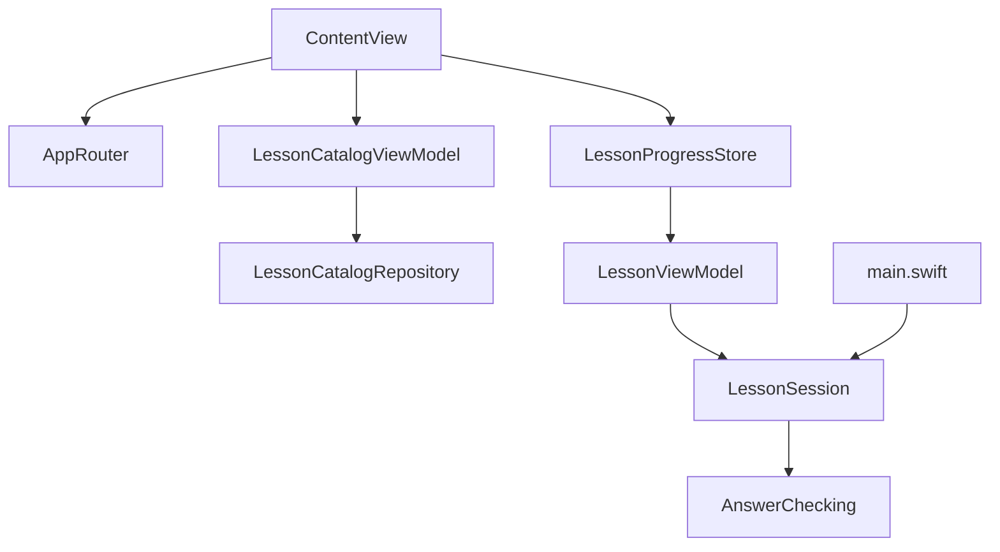

# Архітектура LinguaQuest

## Архітектурне рішення

iOS використовує MVVM. Екрани відображають стан і передають
дії, ViewModel готують дані та повідомлення, LessonSession
керує правилами проходження.

Навігацію відокремлено в AppRouter. ContentView зв’язує
екрани, Router, каталог і хранилище прохождений.
Правила спроб та балів залишаються в LessonSession.

Спільна бібліотека LinguaQuestCore не залежить від SwiftUI
та Combine. Її використовують iOS і консольна версія.

## Відповідальності

| Компонент                      | Відповідальність                            |
|--------------------------------|--------------------------------------------|
| Views                          | Відображення та передавання дій             |
| LessonViewModel                | Стан і повідомлення проходження             |
| LessonCatalogViewModel         | Список уроків, перейменування та помилки     |
| AppRouter                      | Маршрути й модальна презентація             |
| LessonProgressStore            | Зберігання та відновлення ViewModel уроків   |
| LessonSession                  | Спроби, бали, завершення та повтор           |
| LessonCatalogRepository        | Контракт завантаження й перейменування      |
| InMemoryLessonCatalogRepository | Каталог у пам’яті та перевірка даних        |
| main.swift                     | Консольний ввід і вивід                     |

Спільні компоненти розташовані в Sources/LinguaQuestCore.
Навігація та презентація — в iOS/LinguaQuest/LinguaQuest.

## Схема взаємодії

LinguaQuestApp створює репозиторій каталогу, ViewModel,
перевіряльник і фабрику прохождений для LessonProgressStore.

CLI отримує початковий урок через InMemoryLessonRepository.
Обидві версії використовують LoggingAnswerChecker,
AnswerChecker та спільний LessonSession.

## Стан і правила

Правильна відповідь дає 1 бал. Перша помилка дозволяє
повторну спробу, друга завершує запитання з 0 балів.
Підказка та некоректний консольний ввід не витрачають спробу.
Повторна відповідь на завершене запитання ігнорується.

LessonProgressStore зберігає ViewModel за UUID уроку.
Відкриття незавершеного уроку відновлює його стан.
Повторне проходження скидає результат.

Каталог і прогрес зберігаються лише в пам’яті.
Мережа, база даних і збереження між перезапусками відсутні.

## Патерни

| Категорія      | Патерн    | Реалізація                                  |
|----------------|-----------|---------------------------------------------|
| Породжувальний | Builder   | LessonBuilder                               |
| Структурний    | Decorator | LoggingAnswerChecker                        |
| Поведінковий   | Observer  | ObservableObject, @Published, Combine        |

### Builder

LessonBuilder накопичує запитання та перевіряє назву,
наявність запитань, слова, варіанти й правильні індекси.
Метод build повертає Lesson або викидає помилку.

Builder використовується репозиторіями. Під час
перейменування зберігає UUID та перевіряє оновлений урок.

### Decorator

LoggingAnswerChecker реалізує AnswerChecking та обгортає
інший перевіряльник. Він один раз викликає перевірку,
записує повідомлення через передану функцію log
і повертає результат без змін.

В iOS повідомлення видно в консолі Xcode,
у CLI — в терміналі.

### Observer

LessonViewModel і LessonCatalogViewModel публікують стан
через @Published. ContentView зберігає об’єкти через
@StateObject, а LessonPlayView отримує ViewModel
через @ObservedObject.

LessonProgressStore пересилає сповіщення збережених ViewModel.
Підписки зберігаються як AnyCancellable, а замикання
використовує weak self для запобігання циклу сильних посилань.

Механізм спостереження надають Combine і SwiftUI.

## SOLID

| Принцип | Застосування                                             |
|---------|----------------------------------------------------------|
| SRP     | Відображення, навігація, дані та правила розділені          |
| OCP     | Журналювання додається Decorator без зміни сесії           |
| LSP     | Decorator зберігає контракт і результат перевіряльника      |
| ISP     | Малі протоколи AnswerChecking і репозиторіїв               |
| DIP     | Сесія та ViewModel каталогу отримують залежності через протоколи |

Контракт AnswerChecking: недопустимі індекси дають invalid,
правильний допустимий — correct, інший — incorrect.

Заглушка TestAnswerChecker перевіряє впровадження залежності.
Збереження контракту Decorator перевіряється окремим тестом.

## Впровадження залежностей

LessonSession отримує урок, перевіряльник і функцію балів.
LessonViewModel отримує готову сесію.
LessonCatalogViewModel отримує LessonCatalogRepository.
LessonProgressStore отримує фабрику ViewModel.
LoggingAnswerChecker отримує перевіряльник і функцію журналювання.

DI — передавання залежностей ззовні.
DIP — залежність від абстракцій змінюваних компонентів.

## Усунені проблеми

| Проблема                       | Рішення                              |
|--------------------------------|--------------------------------------|
| Дублювання правил CLI та iOS    | Спільний LessonSession               |
| Правила в інтерфейсі           | Session і ViewModel                  |
| Переходи всередині екранів     | AppRouter і передані дії              |
| Втрата стану після повернення  | LessonProgressStore                  |
| Приховані залежності           | Передавання через ініціалізатори      |
| Журналювання в перевіряльнику  | LoggingAnswerChecker                 |

## Перевірки

13 тестів спільного пакета перевіряють Builder,
репозиторії, ідентифікацію, перейменування та Decorator.
Запуск із кореня: swift test.
На Windows: swift test --build-system native.

20 iOS-тестів перевіряють Session, ViewModel проходження,
збереження прогресу та ViewModel каталогу.
Запуск: схема LinguaQuest, ⌘U.

Карта переходів, ручний сценарій і скриншоти:
[Навігація та інтерфейс](navigation.md).
