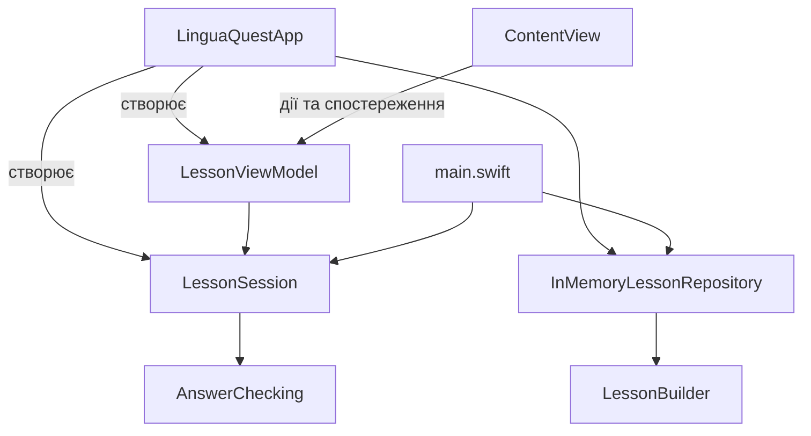

# Архітектура LinguaQuest

## Вибір архітектури

Для iOS обрано MVVM: ContentView відображає стан,
LessonViewModel обробляє дії та готує повідомлення,
LessonSession керує проходженням уроку.

Для невеликого застосунку це дозволяє відокремити інтерфейс
від правил без надмірної кількості компонентів.
ViewModel залежить від Combine, а спільна логіка працює
без SwiftUI та використовується також у консолі.

## Розподіл відповідальностей

| Рівень      | Компоненти                              | Відповідальність                    |
|-------------|-----------------------------------------|-------------------------------------|
| Презентація | ContentView, LessonViewModel, main.swift | Взаємодія з користувачем             |
| Предметна логіка | Question, Lesson, LessonSession, AnswerChecking | Дані, перевірка та проходження |
| Дані        | LessonRepository, InMemoryLessonRepository | Отримання уроку                   |

Спільні компоненти розташовані в Sources/LinguaQuestCore.
Рівні розділено за відповідальністю; окремих модулів
для кожного рівня в цьому невеликому проєкті немає.

## Схема взаємодії

LinguaQuestApp і код запуску CLI отримують урок через
LessonRepository. InMemoryLessonRepository складає його
через LessonBuilder.

Обидві точки запуску створюють LoggingAnswerChecker,
який обгортає AnswerChecker, та передають його в LessonSession.
iOS додатково передає сесію у ViewModel.

## Робочий сценарій

В iOS ContentView передає вибір у LessonViewModel.
ViewModel викликає submitAnswer у спільній сесії.
Сесія перевіряє відповідь, оновлює спроби та бали.
ViewModel синхронізує опублікований стан, і SwiftUI оновлює екран.

У CLI main.swift читає введення та викликає ту саму сесію.
Власних лічильників балів і спроб у консолі немає.

Правильне запитання дає 1 бал, невиконане — 0.
Після першої помилки доступна повторна відповідь.
Підказки та некоректне введення не витрачають спробу.
Сесія ігнорує повторну відповідь на завершене запитання.

## Патерни

| Категорія       | Патерн    | Компоненти                                         |
|-----------------|-----------|----------------------------------------------------|
| Породжувальний  | Builder   | LessonBuilder, Lesson, InMemoryLessonRepository     |
| Структурний     | Decorator | AnswerChecking, AnswerChecker, LoggingAnswerChecker |
| Поведінковий    | Observer  | LessonViewModel, @Published, ContentView            |

### Builder

Проблема: потрібно поетапно складати урок і перевіряти його дані.

LessonBuilder накопичує запитання через addQuestion.
Метод build перевіряє назву, наявність запитань, слова,
варіанти та індекси правильних відповідей.
Після перевірки повертається Lesson або викидається помилка.

InMemoryLessonRepository керує складанням уроку через Builder.
Цей шлях використовується під час запуску обох версій.

### Decorator

Проблема: додати журналювання без зміни правил AnswerChecker.

LoggingAnswerChecker реалізує AnswerChecking та обгортає
інший перевіряльник. Він один раз викликає його, записує
повідомлення через передану функцію log і повертає результат
без змін.

В iOS повідомлення видно в консолі Xcode, у CLI — в терміналі.

### Observer

Проблема: екран має реагувати на зміну стану ViewModel.

LessonViewModel реалізує ObservableObject і публікує
властивості через @Published. ContentView використовує
@StateObject, а SwiftUI оновлює відображення після змін.

Механізм підписок надають Combine і SwiftUI.
Власний реєстр спостерігачів не реалізовано.

Тест testScoreChangesNotifyObserver підписується на $score
через sink і перевіряє отримання значень [0, 1].

## SOLID

| Принцип | Компонент                   | Застосування                                      |
|---------|-----------------------------|---------------------------------------------------|
| SRP     | View, ViewModel, Session    | Відображення, повідомлення та правила розділені    |
| OCP     | AnswerChecking              | Перевіряльник розширюється Decorator без зміни сесії |
| LSP     | LoggingAnswerChecker        | Зберігає результати й контракт обгорнутого компонента |
| ISP     | AnswerChecking, LessonRepository | Малі протоколи для потрібних операцій         |
| DIP     | Session, точки запуску      | Змінювані компоненти використовуються через протоколи |

Контракт AnswerChecking: недопустимі індекси дають invalid,
правильний допустимий індекс — correct, інший — incorrect.
Збереження результатів Decorator перевіряється тестом.

Окремі ієрархії успадкування для демонстрації SOLID не потрібні.

## Впровадження залежностей

LessonSession отримує урок, перевіряльник і функцію
нарахування балів через ініціалізатор.
LessonViewModel отримує готову сесію.
LoggingAnswerChecker отримує перевіряльник і функцію журналювання.

DI — передавання залежностей ззовні.
DIP — залежність від абстракцій змінюваних компонентів.

Тест testInjectedCheckerIsUsed передає TestAnswerChecker
та перевіряє його виклик без зміни коду сесії.
Ця заглушка перевіряє впровадження залежності;
її фіксована відповідь не демонструє весь контракт перевірки.

## Антипатерни та покращення

| Проблема                       | Рішення                                     |
|--------------------------------|---------------------------------------------|
| Перевантажений ContentView     | Правила винесено в Session, повідомлення у ViewModel |
| Дублювання правил CLI та iOS   | Обидві версії використовують LessonSession   |
| Приховані глобальні залежності | Залежності передаються через ініціалізатори  |
| Отримання даних в інтерфейсі   | Урок готується в точці запуску через репозиторій |
| Перевірка разом із журналюванням | Журналювання винесено в Decorator          |

## Перевірки та обмеження

Шість тестів LinguaQuestCoreTests перевіряють Builder,
репозиторій і збереження результатів Decorator.
Запуск із кореня: swift test.
На Windows: swift test --build-system native.

Десять iOS-тестів перевіряють Session та ViewModel:
бали, спроби, некоректні дані, повторне проходження,
впровадження перевіряльника та повідомлення Observer.
Запуск у Xcode: схема LinguaQuest, ⌘U.

Дані уроку зберігаються в пам’яті. Мережа, база даних
і збереження прогресу поки не реалізовані.