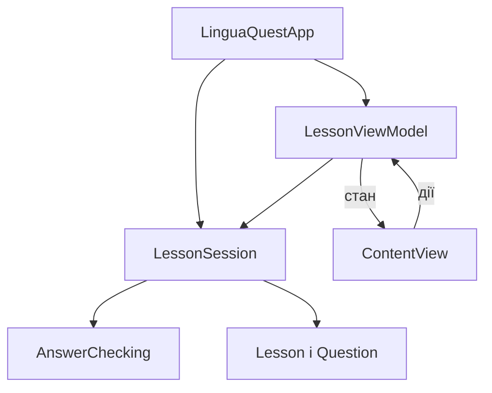

# Архітектура LinguaQuest

## Вибір архітектури

Для iOS-частини використано MVVM. SwiftUI відображає стан
ViewModel та передає їй дії користувача. Це дозволяє
відокремити інтерфейс від правил проходження уроку.

Для невеликого застосунку цей підхід дає зрозумілий розподіл
відповідальностей без великої кількості додаткових компонентів.

## Компоненти

| Компонент        | Відповідальність                                |
|------------------|-------------------------------------------------|
| ContentView      | Відображає стан і передає дії користувача       |
| LessonViewModel  | Готує стан, підказки та повідомлення для екрана |
| LessonSession    | Керує спробами, балами, переходами та повтором  |
| AnswerChecking   | Визначає контракт перевірки відповіді           |
| AnswerChecker    | Реалізує перевірку відповіді                    |
| Question, Lesson | Зберігають дані предметної області              |
| LinguaQuestApp   | Створює компоненти та передає залежності        |

## Схема

## Робочий сценарій

Користувач вибирає відповідь у ContentView.
ViewModel передає індекс у LessonSession.
Сесія викликає AnswerChecking і змінює стан проходження.
ViewModel оновлює дані та повідомлення, які відображає SwiftUI.

Правила нарахування балів передаються в сесію ззовні:
правильно виконане запитання дає 1 бал, невиконане — 0 балів.
Перша помилка дозволяє відповісти повторно без зміни балів.
Підказка не витрачає спробу та не впливає на результат.

Текстові повідомлення формуються у ViewModel.

## Перевірка

- Усі правильні відповіді: 3 виконані запитання, 3 бали.
- Дві помилки на apple, повторна правильна відповідь на book,
  правильна відповідь на sun: 2 виконані запитання, 2 бали.
- Підказка не змінює балів і не витрачає спробу.
- Повторне проходження очищає результат і повідомлення.

## Поведінковий патерн Observer

Проблема: інтерфейс повинен реагувати на зміну балів,
поточного запитання, підказки та повідомлень.

Використано механізм спостереження Combine і SwiftUI.

| Учасник           | Реалізація                                |
|-------------------|-------------------------------------------|
| Джерело стану     | LessonViewModel: ObservableObject         |
| Публікація змін   | Властивості з @Published                  |
| Спостереження UI  | @StateObject у ContentView                |
| Тестовий підписник| Підписка на viewModel.$score через sink   |

LessonViewModel оновлює опубліковані властивості після дій
користувача. SwiftUI отримує повідомлення та оновлює відображення.

Механізм підписок надає фреймворк. Код проєкту визначає
опублікований стан і підключає його до інтерфейсу.

Тест testScoreChangesNotifyObserver створює підписку на бали
та перевіряє отримання значень [0, 1] після правильної відповіді.

## Принципи SOLID

| Принцип | Компонент                                   | Застосування                                                              |
|---------|---------------------------------------------|---------------------------------------------------------------------------|
| SRP     | ContentView, LessonViewModel, LessonSession | Відображення, підготовка стану та правила проходження розділені           |
| OCP     | LessonSession, AnswerChecking               | Сумісний перевіряльник можна підключити без зміни коду сесії              |
| LSP     | Контракт AnswerChecking                     | Робочі реалізації мають однаково трактувати correct, incorrect та invalid |
| ISP     | AnswerChecking                              | Протокол містить тільки потрібну операцію перевірки                       |
| DIP     | LessonSession                               | Сесія отримує перевіряльник через протокол, а не створює AnswerChecker    |

Контракт AnswerChecking: недопустимі індекси дають invalid,
збіг вибраного та правильного індексів — correct,
інший допустимий варіант — incorrect.

Після додавання Decorator потрібно перевірити, що обгортка
зберігає цей контракт і додає тільки журналювання.

Окремі ієрархії успадкування для демонстрації SOLID
не створювалися. Заміна компонентів організована через протокол.

## Впровадження залежностей

LinguaQuestApp створює урок, перевіряльник та функцію
нарахування балів і передає їх у LessonSession.
Готова сесія передається в LessonViewModel.

DI — спосіб передати залежність ззовні.
DIP — принцип залежності від абстракції замість конкретної
реалізації змінюваного компонента.

У тесті testInjectedCheckerIsUsed використовується
TestAnswerChecker замість AnswerChecker

Заглушка повертає наперед заданий результат і фіксує виклики.
Тест перевіряє передачу та використання залежності
без зміни LessonSession.

## Антипатерни та покращення

| Проблема                         | Рішення або поточний стан                                                |
|----------------------------------|--------------------------------------------------------------------------|
| Перевантажений ContentView       | Правила проходження винесено в LessonSession, повідомлення — у ViewModel |
| Приховані залежності             | Компоненти передаються через ініціалізатори                              |
| Створення уроку всередині екрана | Перенесено в LinguaQuestApp                                              |
| Повторне нарахування балів       | Сесія ігнорує відповіді на завершене запитання                           |
| Дублювання між CLI та iOS        | Залишається до переведення CLI на спільний LessonSession                 |

## Наступні етапи

Підключити LinguaQuestCore та перенести до нього LessonSession.
Додати репозиторій уроків, Builder і Decorator.
Перевести консольну версію на спільний LessonSession.
Перевірити збереження контракту перевірки після додавання Decorator.