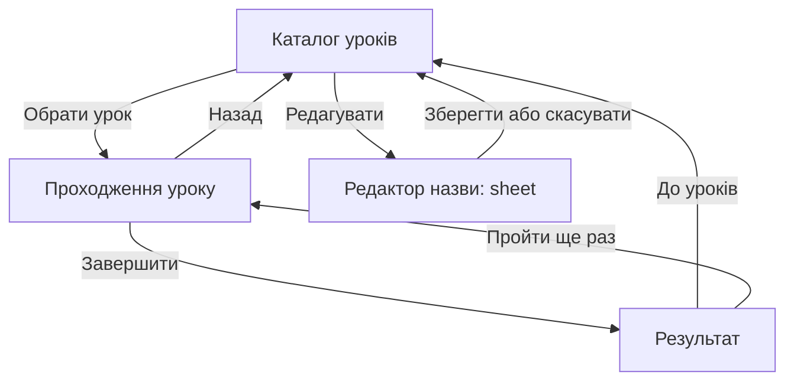

# Навігація LinguaQuest

Статус: план реалізації практичної роботи 3.

## Екрани

| Екран              | Призначення                                  |
|--------------------|----------------------------------------------|
| Каталог уроків     | Вибір уроку та відкриття редактора назви      |
| Проходження уроку  | Відповіді, підказки та поточні бали           |
| Результат          | Підсумок, повторне проходження, повернення    |
| Редактор назви     | Модальна форма збереження або скасування змін |

## Карта переходів

## Керування навігацією

AppRouter зберігає маршрути стекової навігації та стан
модального редактора. Кореневий екран підключає їх
до NavigationStack і sheet.

Маршрут уроку та редактора містить ідентифікатор уроку.
Екран результату отримує підсумок відповідного проходження.

## Дані та стан

Каталог використовує спільне джерело даних через ViewModel.
Після збереження нової назви каталог оновлюється.
Ідентифікатор уроку та його запитання зберігаються.

Редактор працює з чернеткою: скасування не змінює урок.
Порожню назву зберегти не можна.

Незавершене проходження зберігається в пам’яті під час
повернення до каталогу. Повторне проходження з екрана
результату починається з нульових балів.

## Власна анімація

Після натискання «Підказка» її текст з’являється плавно.
Анімація не блокує кнопки та введення.

## Заплановані перевірки

- Відкриття кожного уроку та повернення до каталогу.
- Збереження і скасування редагування.
- Оновлення назви без зміни ідентифікатора.
- Повернення до незавершеного проходження.
- Завершення та повтор уроку.
- Повторні переходи без дублювання екранів.
- Доступність кнопки збереження з відкритою клавіатурою.
- Перевірка на компактному та великому екранах iPhone.