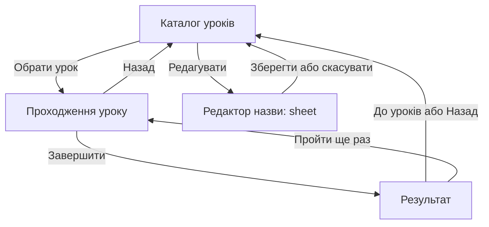

# Навігація LinguaQuest

## Екрани

| Екран             | Призначення                                  |
|-------------------|----------------------------------------------|
| Каталог уроків    | Вибір уроку та відкриття редактора            |
| Проходження уроку | Відповіді, підказки та поточні бали           |
| Результат         | Підсумок, повторне проходження, повернення    |
| Редактор назви    | Модальна форма збереження або скасування змін |

## Карта переходів

## Керування переходами

AppRouter зберігає стек маршрутів path і стан модальної
презентації sheet. ContentView підключає їх до NavigationStack
та sheet і визначає відповідні екрани.

Каталог є кореневим екраном. Маршрути уроку й редактора
передають UUID вибраного уроку. Екран результату отримує
незмінний підсумок LessonResult.

Після завершення уроку маршрут результату замінює маршрут
проходження. Повернення з результату відкриває каталог.

## Дані та збереження стану

LessonCatalogViewModel отримує дані через
LessonCatalogRepository. Після перейменування оновлюється
відповідний урок у списку. UUID та запитання зберігаються.

Редактор працює з локальною чернеткою. Скасування або закриття
форми не змінює назву. Порожню назву зберегти неможливо.

LessonProgressStore зберігає LessonViewModel для кожного UUID.
Повернення до каталогу та повторне відкриття незавершеного
уроку зберігають запитання, спроби, бали й підказку.
Перейменування оновлює назву без скидання проходження.

Повторне проходження починається з першого запитання
та нульових балів. Прогрес різних уроків незалежний.

Каталог і прогрес зберігаються в оперативній пам’яті.
Після повного перезапуску створюються демонстраційні дані.

## Власна анімація

Після натискання «Підказка» блок з’являється з прозорістю
та зміщенням. Використано withAnimation, easeInOut
тривалістю 0,25 секунди та transition.

Анімація не блокує відповіді. Якщо ввімкнено Reduce Motion,
власна анімація вимикається, а підказка залишається доступною.

## Інструкція перевірки сценарію

1. Відкрити каталог із двома уроками.
2. Змінити назву першого уроку та зберегти.
   Переконатися, що каталог показує нову назву.
3. Повторно відкрити редактор, змінити чернетку та скасувати.
   Збережена назва має залишитися попередньою.
4. Почати перший урок, відповісти «яблуко», перейти до book
   та відкрити підказку. Повернутися до каталогу.
5. Натиснути «Продовжити». Мають зберегтися book, 1 бал
   і підказка. Перейменування цього уроку не скидає прогрес.
6. Відповісти «книга» та «сонце». Результат: 3 із 3, 3 бали.
7. Натиснути «Пройти ще раз». Очікуються apple, 0 балів
   і відсутність попередніх повідомлень.
8. Перевірити «До уроків» із результату та відкриття другого
   уроку. Другий урок починається зі слова airport.

Додатково: дві помилки на apple та правильні відповіді
на book і sun дають 2 із 3 та 2 бали.

## Перевірка інтерфейсу

| Пристрій                   | iOS  |
|----------------------------|------|
| iPhone SE (3rd generation)  | 18.3 |
| iPhone 16 Pro               | 18.3 |

На обох розмірах перевірено читабельність тексту,
доступність кнопок, роботу редактора з клавіатурою,
прокручування та повторні переходи.

## Скриншоти

| Екран      | iPhone SE                                           | iPhone 16 Pro                                     |
|------------|-----------------------------------------------------|---------------------------------------------------|
| Каталог    | [Відкрити](screenshots/lab3/compact-catalog.png)      | [Відкрити](screenshots/lab3/large-catalog.png)      |
| Урок       | [Відкрити](screenshots/lab3/compact-lesson.png)       | [Відкрити](screenshots/lab3/large-lesson.png)       |
| Редактор   | [Відкрити](screenshots/lab3/compact-editor.png)       | [Відкрити](screenshots/lab3/large-editor.png)       |
| Результат  | [Відкрити](screenshots/lab3/compact-result.png)       | [Відкрити](screenshots/lab3/large-result.png)       |
